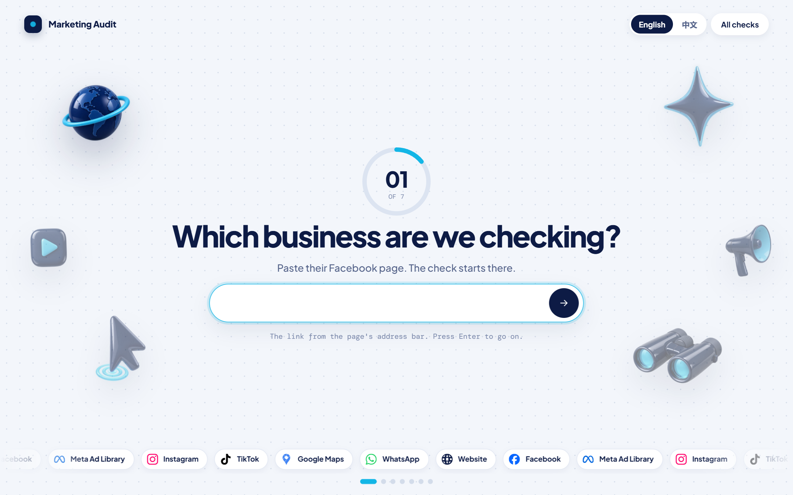
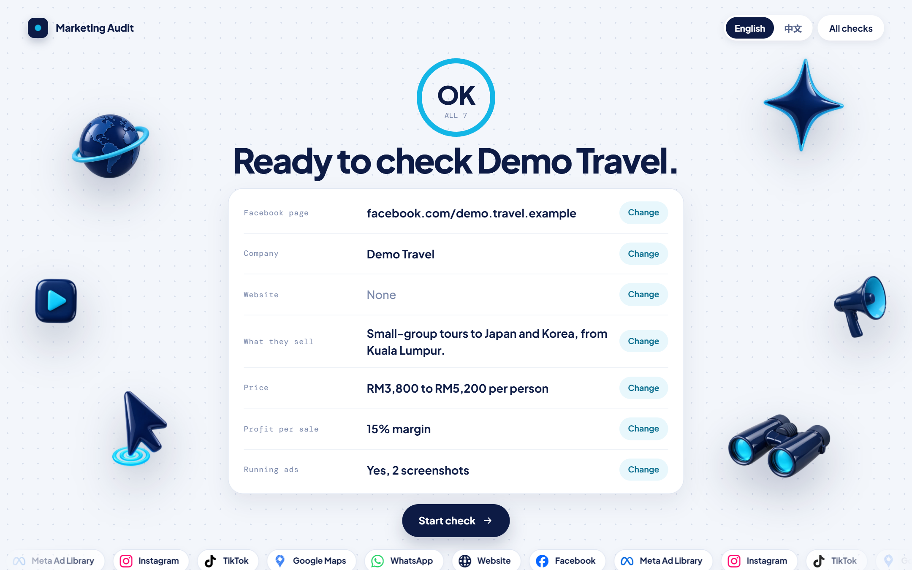
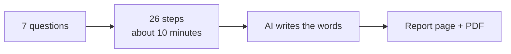
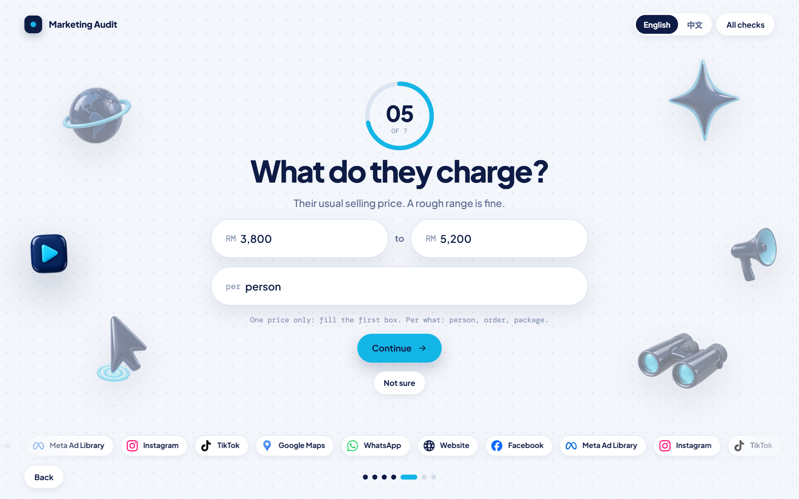

<p align="center">
  
</p>

<h1 align="center">Marketing Audit</h1>

<p align="center">
  Answer 7 questions about a business. About 10 minutes later you have a full marketing audit,<br>
  with a screenshot as proof for every finding. In English or 中文. On your own PC.
</p>

<p align="center">
  <a href="README.zh.md">中文说明</a> ·
  <a href="#setup">Setup</a> ·
  <a href="#what-it-checks">What it checks</a> ·
  <a href="#responsible-use">Responsible use</a>
</p>

<p align="center">
  
  
  
  
</p>

---

## Why

Before a first call with a new lead, a marketer checks the same things every time: where the business shows up, what they post, whether they run ads, who their competitors are, how a customer buys, and whether their videos hold attention. Done by hand it takes an afternoon, and every report looks different.

This app does the same checks the same way every time, keeps a screenshot of everything it saw, and writes the report for you.

## What you get

- **Form in, report out.** No stops in the middle.
- **Proof for everything.** Every fact has a screenshot. Click it to zoom.
- **Code collects, AI writes.** The code opens the pages and counts the numbers. The AI reads screenshots and writes the words. A checker flags any number in the AI's words that isn't in the collected data.
- **Competitors included.** It finds who else sells the same thing with ads, opens their ads and compares.
- **Insight, not a copy of the screenshot.** It works out whether the ad money pays, from the business's own price and profit.
- **English or 中文 (Malaysian Chinese).** One switch changes every screen and the report. The 中文 report is written in Chinese from the start, not translated.
- **A report page and a PDF.** Ready to read before the call, or to send.

<p align="center">
  
  
</p>

## How it works



**The 7 questions** (one per screen): the Facebook page, the company name, the website, what they sell, what they charge, what they keep from one sale, and whether they run ads (with their Ads Manager screenshots if they do). The website, what they sell, the price and the profit can be skipped.

<p align="center">
  
</p>

## What it checks

The run has 26 steps in 7 groups. You can watch them live, or leave the page and come back.

| Group | What it looks at |
|---|---|
| **1. Channels** | Website (does it load, is there a shop), Facebook page (followers, page button, newest post), Instagram, TikTok, Google Maps, app links |
| **2. Own content** | The newest 10 Facebook Reels with views and previews, post dates, the first seconds of each video |
| **3. Ads** | Page transparency, the Meta Ad Library (all countries, live and past), their website in the Ad Library, same-name pages, website tracking (Meta pixel, Google tag, TikTok pixel, WhatsApp button), their live ads opened one by one, and their Ads Manager screenshots |
| **4. Competitors** | Search words from what they sell, Ad Library searches, the real competitors picked out, their ads opened one by one |
| **5. Call to action** | Landing pages on computer and phone, a first-screen checklist (headline length, button above the fold, offer, proof), buying steps, dead links |
| **6. Creative** | The first 3 seconds of their videos and the competitors', with one fix for each |
| **7. Report** | The AI writes the report (and the 中文 one), the code builds the page and the PDF |

### The report

Cover verdict, At a glance, then 01 Channels, 02 Own content, 03 Ads, 04 Competitor ads (and the ways they sell through ads), 05 Call to action, 06 Creative, 07 What to try (their offer, their own lines rewritten as the change in the customer's life, 3 or 4 phone-shot ad formats and a 3-week test order) and 08 Next steps (what to fix first, a weekly creative routine, 5 questions for the owner).

### "Is the ad money working?"

When the owner shares Ads Manager screenshots, the app doesn't repeat "spent X on campaign Y". It works out:

- **Cost per chat or lead**, from the screenshots
- **Break-even**: profit per sale ÷ cost per chat = how many chats they can afford for one sale
- **Their funnel's own steps** (chat, lead form or checkout), each with the number we have or a question for the owner
- **Insight lines**, only when true: money in campaigns that cost too much, cheapest vs dearest campaign, money spent on likes when the sale happens in chat

No fixed rule like "ads should cost 10% of the price", and no guessed close rates. Every funnel has its own numbers.

## What you need

| Need | Why | Get it |
|---|---|---|
| Windows 10 or 11 | What it's built and tested on. macOS and Linux should work but are untested. | |
| Node.js 20.9 or newer | Runs the app | [nodejs.org](https://nodejs.org) |
| Google Chrome | Opens the pages and prints the PDF | [google.com/chrome](https://www.google.com/chrome/) |
| ffmpeg | Cuts video frames for the previews | `winget install Gyan.FFmpeg` |
| Claude Code, logged in | The AI that reads and writes. A Claude Pro or Max plan, or an API key | `npm install -g @anthropic-ai/claude-code`, then run `claude` once to log in |
| An Apify account (optional) | Only for TikTok, see below | [apify.com](https://apify.com) |

## Setup

```bash
git clone https://github.com/aming-nocode/marketing-audit.git
cd marketing-audit
npm install
cp .env.example .env.local      # PowerShell: Copy-Item .env.example .env.local
npm run build
npm run start
```

Then open **http://127.0.0.1:3130**.

On Windows you can also double-click **`Start Audit App.cmd`**. It installs, builds, opens the browser and keeps the app running. Close its window to stop it.

### Settings (`.env.local`)

| Setting | What it does |
|---|---|
| `APIFY_API_KEY` | Optional. Lets the app read TikTok through Apify when TikTok blocks it. |
| `CONSULTANT_NAME` | Your name, the way the report should say it ("Weekly review with ..."). Empty = "the consultant". |
| `CLAUDE_BIN` | Only if the app can't find Claude Code by itself. |
| `APP_TIMEZONE` | Time zone for dates. Default `Asia/Kuala_Lumpur`. |

### Apify (for TikTok)

TikTok often shows a puzzle to automated browsers. The app never tries to solve it. If you add an Apify token, it reads the TikTok profile through Apify's [TikTok Profile Scraper](https://apify.com/clockworks/tiktok-profile-scraper) instead (at most 2 profiles per check).

1. Sign up at [apify.com](https://apify.com). The Free plan includes US$5 of usage every month, no credit card needed.
2. Copy your token from [Console, Settings, API & Integrations](https://console.apify.com/settings/integrations).
3. Paste it into `.env.local` as `APIFY_API_KEY=...` and restart the app.

In our runs it cost about US$0.003 per video, about US$0.01 per check, so the free credit covers hundreds of checks. Check the current price on the scraper's page. Without a token, the TikTok step just says "Not checked".

## Time and cost

| | |
|---|---|
| One full check | about 9 to 10 minutes |
| AI | about US$1 per check, as Claude Code reports it (on a Pro or Max plan it counts against your plan's usage) |
| The 中文 report | about 5 more minutes, about US$0.60 |
| Apify | about US$0.01 per check, only when TikTok blocks |
| New price or profit later | only the report is written again, not the whole check |

## Privacy

- Everything stays on your PC: the database, the screenshots, the reports.
- The AI runs through your own Claude Code login.
- Apify only receives the TikTok usernames to look up.
- Nothing is posted anywhere, and there is no account or login in the app.

## Responsible use

- The app reads **public pages, logged out**, the way a customer would, one page at a time.
- It never logs in, and it never solves robot checks or puzzles. When a site blocks it, that step says "Not checked".
- Facebook, Instagram, TikTok and Google have their own terms about automated access. Use the app for research on public information, at a human pace, and follow those terms. You are responsible for how you use it.
- The report is a starting point for a conversation with the owner, not a verdict. Ads Manager numbers come only from the screenshots the owner shares, and sales that close in WhatsApp or Messenger never show in Ads Manager, so the report turns them into questions for the call.

## For developers

```bash
npm run dev            # http://127.0.0.1:3130 with live reload
npm run typecheck
npm run check:design   # the design rules in CLAUDE.md, checked in code
npm run test:flow      # end-to-end test on a throwaway copy, fake data, no real AI (132 checks)
```

| Folder | What's in it |
|---|---|
| `app/` | Pages and routes (Next.js App Router) |
| `components/` | The start flow, run panel, report frame, viewer, language switch |
| `lib/collect/` | The 26 run steps (Playwright, logged out) |
| `lib/report/` | The ad money maths, the AI writers, the report page and PDF |
| `lib/ai.ts` | Every AI call: `claude -p` with a JSON schema, logged per check |
| `db/migrations/` | The database (PGlite, a Postgres that lives in a folder) |

Built with Next.js, React, Tailwind, PGlite, Playwright, ffmpeg and Claude Code. Channel logos from [Simple Icons](https://simpleicons.org). The 3D objects were made with an image model for this app.

Built step by step with [Claude Code](https://claude.com/claude-code).

## Licence

[MIT](LICENSE). Brand names and logos belong to their owners.
