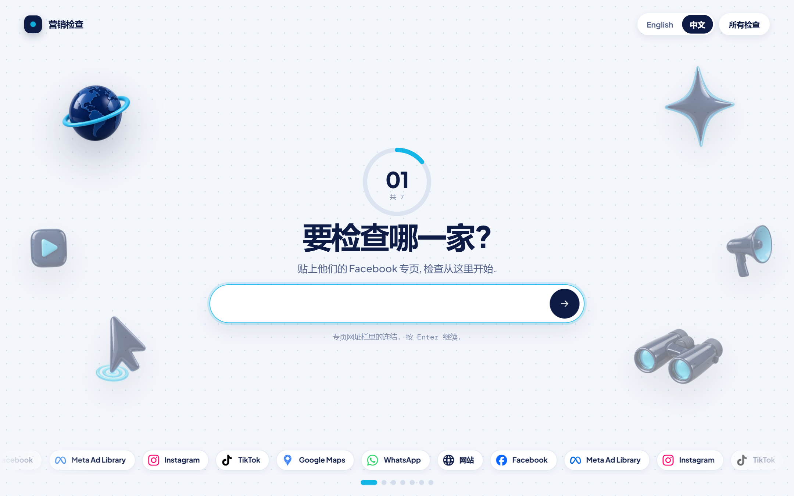
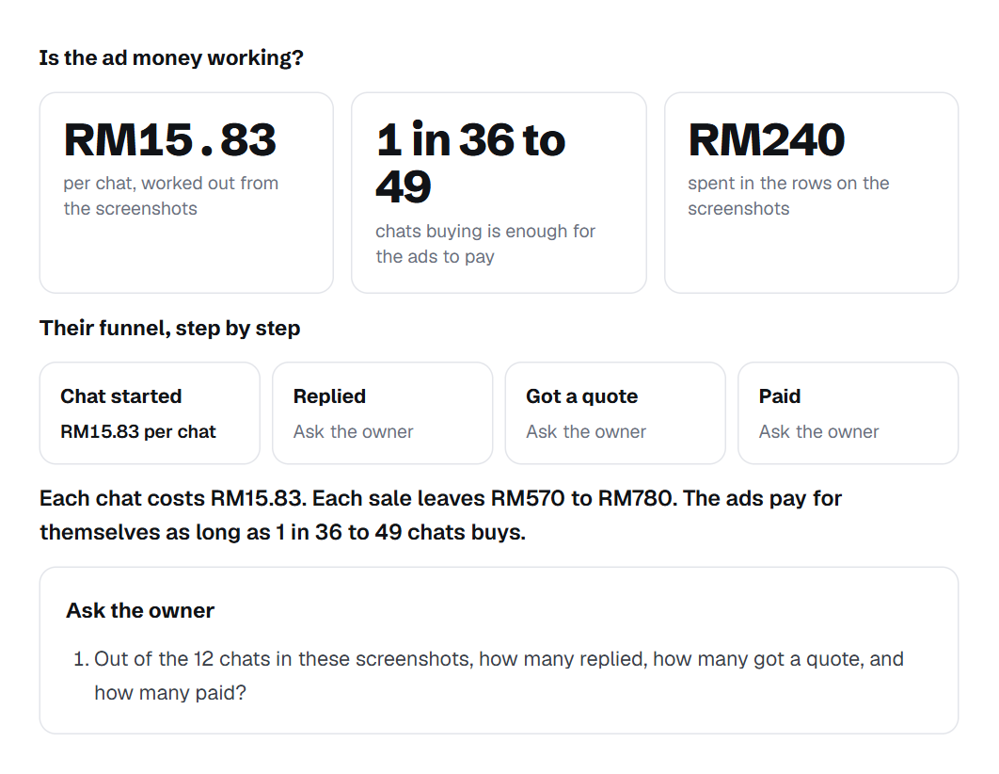
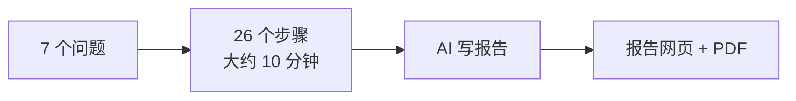

<p align="center">
  
</p>

<h1 align="center">Marketing Audit 营销检查</h1>

<p align="center">
  回答 7 个关于一家公司的问题, 大约 10 分钟后, 一份完整的营销检查报告就好了.<br>
  每一个发现都有截图做证明. 英文或中文都可以, 全部在你自己的电脑跑.
</p>

<p align="center">
  <a href="README.md">English</a> ·
  <a href="#安装">安装</a> ·
  <a href="#检查什么">检查什么</a> ·
  <a href="#使用守则">使用守则</a>
</p>

---

## 为什么要做这个

每次跟新客户第一次通话之前, 做 marketing 的人都会查一样的东西: 他们在哪些平台, 有没有自己拍 video, 有没有跑广告, 同行是谁, 客人怎样下单, video 开头留不留得住人. 用手一个一个查, 要花一个下午, 每次做出来的报告也不一样.

这个 app 每次都用同样的方法查同样的东西, 看到的每一样都截图留底, 然后帮你把报告写好.

**适合谁用.** 这是为**马来西亚的生意**做的: 价钱用 RM, 同行广告在马来西亚的 Meta 广告库搜寻, 关键字用英文, 中文和马来文. 报告是写给**顾问**看的: 顾问给方向, 教方法, 内容和广告由公司自己的团队做. 在 `CONSULTANT_NAME` 填你的名字, 报告就会用你的名字.

## 你会得到什么

- **填资料进去, 报告出来.** 中间不用停.
- **每一点都有证明.** 每个发现都有截图, 点一下就放大.
- **code 收集, AI 写字.** 打开网页, 数数字, 全部是 code 做. AI 只负责看截图和写字. 如果 AI 写了收集资料里没有的数字, 系统会标出来.
- **连同行也查.** 找出谁也在用广告卖一样的东西, 打开他们的广告来比较.
- **给 insight, 不是抄截图.** 例如用他们自己的售价和利润, 算出广告到底有没有回本.
- **英文或中文 (大马华语).** 一个按钮换掉所有画面和报告. 中文报告是直接用中文写, 不是翻译.
- **报告网页 + PDF.** 通话前看, 或者直接发给老板.

<p align="center">
  
</p>

## 怎样运作



**7 个问题** (一页一题): Facebook 专页, 公司名字, 网站, 卖什么, 卖多少钱, 一单赚多少, 有没有跑广告 (有的话放上 Ads Manager 截图). 网站, 卖什么, 价钱和利润都可以跳过.

## 检查什么

一共 26 个步骤, 分成 7 组. 可以看着它跑, 也可以先离开这一页.

| 组别 | 看什么 |
|---|---|
| **1. 渠道** | 网站 (打不打得开, 有没有网店), Facebook 专页 (followers, 专页按钮, 最新贴文), Instagram, TikTok, Google Maps, app 连结 |
| **2. 自己的内容** | 最新 10 个 Facebook Reels 的观看次数和预览, 发布日期, 每个 video 的开头几秒 |
| **3. 广告** | 专页透明度, Meta 广告库 (所有国家, 包括已经停的), 广告库里提到他们网站的广告, 同名专页, 网站追踪 (Meta pixel, Google tag, TikTok pixel, WhatsApp 按钮), 一个一个打开他们正在跑的广告, 还有 Ads Manager 截图 |
| **4. 同行** | 从他们卖的东西想出搜寻关键字, 在广告库搜寻, 挑出真正的同行, 一个一个打开同行的广告 |
| **5. Call to action** | 电脑和手机的着陆页, 首屏检查 (标题长度, 首屏有没有按钮, 优惠, 证明), 购买步骤, 失效连结 |
| **6. Creative** | 他们和同行的 video 开头 3 秒, 每个给一个修改建议 |
| **7. 报告** | AI 写英文报告 (和中文报告), code 做成网页和 PDF |

### 广告的钱有没有回本?

老板给了 Ads Manager 截图的话, app 不会只是重复 "花了多少钱, 哪个 campaign". 它会算出:

- **每个聊天或 lead 的成本**, 从截图算出来
- **回本点**: 一单赚多少 ÷ 每个聊天的成本 = 卖一单最多可以花几个聊天的钱
- **他们自己的成交流程** (聊天, 表格或网店), 每一步有数字就放数字, 没有就变成问老板的问题
- **insight**, 只在真的有的时候才写: 钱花在太贵的 campaign, 最便宜和最贵的 campaign 差多少, 生意在聊天成交却花钱买 likes

不用固定的 "广告费应该是售价的 10%", 也不乱猜成交率. 每个 funnel 都有自己的数字.

## 需要什么

| 需要 | 用来做什么 | 去哪里拿 |
|---|---|---|
| Windows 10 或 11 | 在这里开发和测试. macOS 和 Linux 应该可以, 但没有测试过 | |
| Node.js 20.9 或以上 | 跑这个 app | [nodejs.org](https://nodejs.org) |
| Google Chrome | 打开网页, 做 PDF | [google.com/chrome](https://www.google.com/chrome/) |
| ffmpeg | 剪 video 画面做预览 | `winget install Gyan.FFmpeg` |
| Claude Code (已登入) | 负责看和写的 AI. 需要 Claude Pro 或 Max plan, 或者 API key | `npm install -g @anthropic-ai/claude-code`, 然后跑一次 `claude` 登入 |
| Apify account (可选) | 只用在 TikTok, 看下面 | [apify.com](https://apify.com) |

## 安装

```bash
git clone https://github.com/aming-nocode/marketing-audit.git
cd marketing-audit
npm install
cp .env.example .env.local      # PowerShell: Copy-Item .env.example .env.local
npm run build
npm run start
```

然后打开 **http://127.0.0.1:3130**.

Windows 也可以直接双击 **`Start Audit App.cmd`**. 它会安装, build, 打开浏览器, 然后一直开着. 关掉那个窗口就会停.

### 设定 (`.env.local`)

| 设定 | 做什么 |
|---|---|
| `APIFY_API_KEY` | 可选. TikTok 挡住的时候, 用 Apify 读 TikTok |
| `CONSULTANT_NAME` | 你的名字, 报告里会这样写 ("每周跟 ... 检讨"). 空的话就写 "顾问" |
| `CLAUDE_BIN` | app 找不到 Claude Code 的时候才需要 |
| `APP_TIMEZONE` | 日期用的时区. 默认 `Asia/Kuala_Lumpur` |

### Apify (给 TikTok 用)

TikTok 常常会对自动浏览器出拼图. app 不会去解它. 如果你放了 Apify token, 它会改用 Apify 的 [TikTok Profile Scraper](https://apify.com/clockworks/tiktok-profile-scraper) 读 TikTok profile (每个检查最多 2 个).

1. 去 [apify.com](https://apify.com) 注册. Free plan 每个月有 US$5 的用量, 不需要信用卡.
2. 在 [Console, Settings, API & Integrations](https://console.apify.com/settings/integrations) copy 你的 token.
3. 放进 `.env.local`: `APIFY_API_KEY=...`, 然后重开 app.

我们跑的时候, 每个 video 大约 US$0.003, 每个检查大约 US$0.01, 所以免费的额度够跑几百个检查. 实际价钱以 scraper 页面为准. 没有 token 的话, TikTok 那一步就会写 "没检查到".

## 时间和费用

| | |
|---|---|
| 一个完整检查 | 大约 9 到 10 分钟 |
| AI | 每个检查大约 US$1 (Claude Code 显示的数字, 用 Pro 或 Max plan 的话是算进 plan 的用量) |
| 中文报告 | 多大约 5 分钟, 大约 US$0.60 |
| Apify | 每个检查大约 US$0.01, 只在 TikTok 挡住的时候用 |
| 之后才改价钱或利润 | 只重写报告, 不用整个重跑 |

## 隐私

- 所有东西都留在你的电脑: 资料库, 截图, 报告.
- AI 用的是你自己的 Claude Code 登入.
- Apify 只会收到要查的 TikTok username.
- 不会帮你发布任何东西, app 也没有 account 或登入.

## 使用守则

- app 只看**公开的网页, 不登入**, 跟一般客人看到的一样, 一次开一页.
- 它不会登入, 也不会去解机器人检查或拼图. 被挡住的话, 那一步就写 "没检查到".
- Facebook, Instagram, TikTok 和 Google 对自动浏览都有自己的条款. 请只用来研究公开资料, 用正常的速度, 并遵守那些条款. 怎样使用, 由你自己负责.
- 报告是跟老板谈的开始, 不是判决. Ads Manager 的数字只来自老板给的截图, 在 WhatsApp 或 Messenger 成交的生意也不会出现在 Ads Manager, 所以报告会把它们变成通话时要问的问题.

## 给开发者

```bash
npm run dev            # http://127.0.0.1:3130, 改了会自动更新
npm run typecheck
npm run check:design   # CLAUDE.md 里的设计规则, 用 code 检查
npm run test:flow      # 在一个测试副本上从头跑到尾, 假资料, 不用真的 AI (132 项)
```

用 Next.js, React, Tailwind, PGlite, Playwright, ffmpeg 和 Claude Code 做的. 渠道 logo 来自 [Simple Icons](https://simpleicons.org). 3D 图案是用图像模型为这个 app 做的.

用 [Claude Code](https://claude.com/claude-code) 一步一步做出来.

## License

[MIT](LICENSE). 品牌名字和 logo 属于它们的主人.
